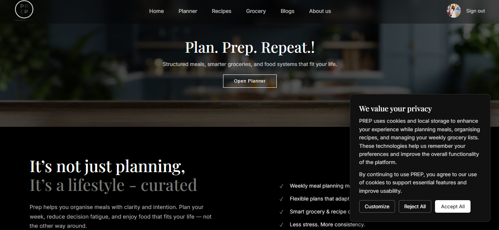
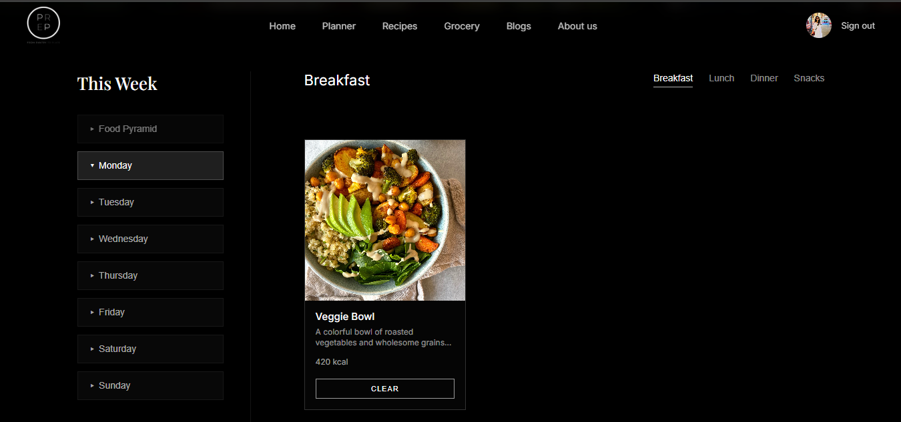
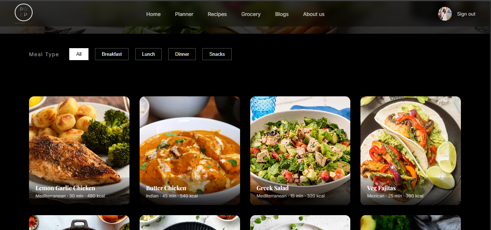
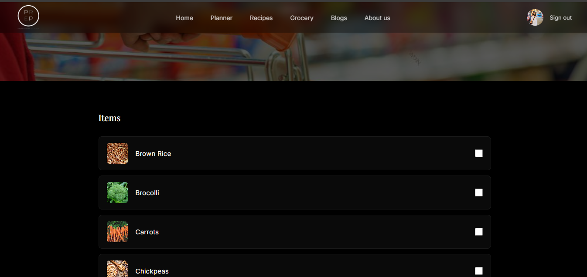

# 🍽️ PREP — Smart Meal Planner

PREP is a full-stack MERN meal planning application that helps users organise weekly meals, explore recipes, and automatically generate grocery lists based on selected meals.

The platform simplifies meal planning by combining recipe discovery, weekly planning, and grocery management in one place.

---

## 🌐 Live Demo

Live Application  
https://prep-app-neon.vercel.app

---

## 📸 Screenshots

  
  

  
  

---

## ✨ Features

- Browse and explore recipes  
- Plan meals for the entire week  
- Automatically generate grocery lists based on selected meals  
- Secure user authentication using JWT  
- Email integration for notifications  
- Privacy controls: Accept, Reject or Customize optional storage, changeable any time from the footer  
- Account deletion from the profile page  
- Pantry shop with a cart (online payment is not available yet; see Known limitations)  
- Responsive modern UI with a dark theme  

---

## 🧰 Tech Stack

### Frontend
- React
- React Router
- CSS

### Backend
- Node.js
- Express.js

### Database
- MongoDB
- MongoDB Atlas

### Authentication
- JWT (JSON Web Tokens)

### Email Service
- Resend API

### Deployment
- Frontend hosted on Vercel
- Backend hosted on Render
- Database hosted on MongoDB Atlas

---

## 🏗️ Architecture Overview

The application follows a MERN stack architecture:

    React Frontend
          │
          ▼
    REST APIs (Node + Express)
          │
          ▼
    MongoDB Database

React handles UI rendering and routing.  
Node.js + Express provides REST APIs for authentication, recipes, planners, and grocery lists.  
MongoDB stores users, recipes, meal plans, and grocery list data.

---

## 📂 Project Structure

    prep
    │
    ├── frontend
    │   └── src
    │       ├── components
    │       ├── pages
    │       ├── data          (recipes and pantry product catalog)
    │       ├── redux         (cart)
    │       ├── utils         (API client, consent, avatar helpers)
    │       ├── styles
    │       └── test          (test setup)
    │
    ├── backend
    │   ├── app.js            (Express app without a listener, imported by tests)
    │   ├── server.js         (loads .env, connects MongoDB, listens)
    │   ├── controllers
    │   ├── routes
    │   ├── models
    │   ├── middleware
    │   ├── utils
    │   ├── emails
    │   └── tests
    │
    └── README.md

---

## ⚙️ Getting Started

### Clone the Repository

    git clone https://github.com/Chai0405/prep-app.git

---

## 📦 Install Dependencies

### Frontend

    cd frontend
    npm install

### Backend

    cd backend
    npm install

---

## 🔑 Environment Variables

Copy the examples and fill in your own values. Never commit a real `.env`
(both are git-ignored).

    cp backend/.env.example backend/.env
    cp frontend/.env.example frontend/.env

| Variable | Where | Required | Purpose |
|---|---|---|---|
| `MONGO_URI` | backend | yes | MongoDB connection string |
| `JWT_SECRET` | backend | yes | Signs login tokens. Use a long random value |
| `CLIENT_URL` | backend | yes | Frontend URL: used in email links and allowed by CORS |
| `RESEND_API_KEY` | backend | for email | Sends verification and password emails |
| `MAIL_FROM` | backend | for email | Sender address for those emails |
| `PORT` | backend | no | Defaults to 5000 |
| `CORS_ORIGINS` | backend | no | Extra allowed frontend origins, comma-separated |
| `VITE_API_URL` | frontend | yes | Backend base URL. Public: it is bundled into the browser |

The server refuses to start if `MONGO_URI`, `JWT_SECRET` or `CLIENT_URL` is missing.

To load the sample recipes into your database (this **replaces** all existing recipes):

    cd backend
    npm run seed

---

## ▶️ Run the Application

### Start Backend

    cd backend
    npm run dev

### Start Frontend

    cd frontend
    npm run dev

Open the application in your browser

    http://localhost:5173

---

## 🧪 Tests and checks

    cd backend
    npm test          # Vitest + Supertest against an in-memory MongoDB

    cd frontend
    npm test          # Vitest + Testing Library (jsdom)
    npm run lint
    npm run build

Backend tests never touch a real database or service. Each test file starts
its own throwaway MongoDB (`mongodb-memory-server-core`, which downloads a MongoDB
binary on the first run), `dotenv` is mocked so the real `.env` is never read,
and email sending is mocked. If the binary can't be downloaded (offline or a
blocked network), point `MONGOMS_SYSTEM_BINARY` at a locally installed `mongod`.

---

## 🔐 Authentication and security

- Email + password. Passwords are hashed with bcrypt and must be at least 10 characters.
- Login returns a JWT valid for 7 days. The frontend sends it as an
  `Authorization: Bearer` header from `localStorage`; it is also set as an
  httpOnly, `Secure`, `SameSite=None` cookie. The header path exists because
  browsers that block third-party cookies would otherwise break sign-in when
  the frontend and backend are on different domains.
- Every protected request re-checks the database, so a token stops working when
  the account is deleted and after a password change or reset. Changing the
  password signs out every other session; the session that made the change
  gets a fresh token.
- Password-reset tokens are stored hashed and expire after 10 minutes. Login and
  "forgot password" don't reveal whether an email has an account.
- Auth endpoints are rate limited: 20 attempts per 15 minutes per IP (10 for account deletion).
- CORS allows only `CLIENT_URL`, `CORS_ORIGINS` and `http://localhost:5173`.
- Trade-off: a token in `localStorage` can be read by any script on the page, so
  an XSS bug would expose it. Never render user content with `dangerouslySetInnerHTML`.

---

## 🗑️ Account deletion

Profile → Danger Zone → Delete Account. The user must be signed in, enter their
current password and type `DELETE`. The server then permanently deletes:

- the user's meal plans (Planner)
- their grocery list (Grocery)
- their newsletter subscription (Newsletter, matched by email)
- the user record itself

PREP stores no orders or payment records yet, so nothing is retained. When
payments are added, decide which order records must be kept for accounting or
legal reasons, and anonymize their personal details instead of deleting them.

---

## 🍪 Privacy controls

| Category | What | Can be turned off |
|---|---|---|
| Essential | sign-in token, auth cookie, the privacy choice itself | no |
| Preferences | cart saved between visits (`localStorage`) | yes |

Until the visitor chooses, and after "Reject All", the cart still works but is
kept in memory only. Withdrawing consent deletes the saved cart. The choice can
be changed at any time from **Privacy settings** in the footer. PREP has no
analytics or advertising cookies. Fonts are loaded from Google Fonts (a
third-party request); self-hosting them would remove that.

The Privacy, Terms and Accessibility pages are **placeholders that have not been
legally reviewed** and must be replaced before production use.

---

## ⚠️ Known limitations

- **Payments:** online payment is not implemented. Checkout says payment isn't
  available and never confirms an order. Server-side payment verification is
  required before taking real orders.
- **Social login:** the Google and Facebook buttons are disabled placeholders.
- **Avatars** are stored in MongoDB as small base64 images. The browser resizes
  them to 256 px, and the server accepts only PNG, JPEG, WebP or GIF up to 300 KB,
  checking each file's real signature bytes. Avatars uploaded before this check
  may be larger; they were left as they are (no migration was run).
- **Changing your email** in the profile does not re-verify the new address.
- **No lazy loading of pages.** Some shared components (cart sidebar, product
  cards, planner modal, footer) are styled by CSS files that belong to other
  pages, and a few selectors are defined twice (auth/register/landing). Splitting
  the bundle per page would leave them unstyled until that page was visited.
  To do it safely, first move each component's styles into a CSS file the
  component imports itself.

---

## 🚢 Deployment

- **Backend (Render):** set every required variable from the table above.
  `CLIENT_URL` must be the exact live frontend origin (no trailing slash), or the
  browser will block API calls.
- **Frontend (Vercel):** set `VITE_API_URL` to the backend URL. `vercel.json`
  rewrites every route to the single-page app.
- Run both test suites and `npm run build` before deploying.

---

## 🚀 Future Improvements

- Nutritional analysis for recipes  
- Drag-and-drop weekly planner  
- Grocery list export (PDF)  
- Online payments with server-side verification  
- Social login (Google / Facebook)  
- Recipe recommendation system  

---

## 👩‍💻 Author

Chaithra Hegde  
MERN Stack Developer

GitHub  
https://github.com/Chai0405

Portfolio  
https://chai0405.github.io/portfolio/

---

## 📜 License

This project is created for learning and portfolio purposes.
